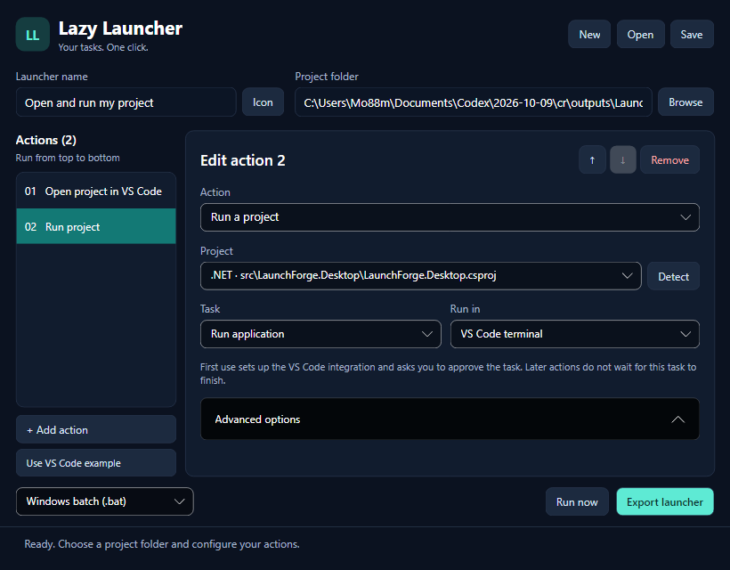

# Lazy Launcher

Set it up once. Launch it with one click.

A local .NET desktop app for Windows and Linux. Configure ordered commands and export a launcher to run them with one click.

Choose actions and fill in simple options. Commands are optional: **Custom command** remains available for anything the built-in actions do not cover.



## Guided actions

- **Run a project**: detect .NET, Node.js, or common Python entry points and select a task.
- **Open project in VS Code**: choose a folder or use the shared project folder.
- **Open a website**, **Open a folder**, and **Open an application**.
- **Custom command**: enter Windows and/or Linux commands, including commands to run inside VS Code.

Project detection reads `.csproj`, `package.json` scripts, and `main.py`, `app.py`, or `manage.py`. It scans the chosen folder and two directory levels below it, excludes dependency/build folders, and prefers runnable projects. Choose from detected projects when a folder contains several. Detection does not install project dependencies or execute project files.

The source projects and VS Code integration identifier retain their original `LaunchForge` names for compatibility. The Windows desktop executable is `LazyLauncher.exe`.

## Run the desktop app

Install the .NET 10 SDK, then run from this repository:

```sh
dotnet restore LaunchForge.slnx
dotnet run --project src/LaunchForge.Desktop
```

On Windows you can also double-click `start-windows.bat`. On Linux use `bash start-linux.sh`.

The desktop interface uses Avalonia 11. On Linux it needs a graphical desktop and Avalonia's native desktop dependencies: https://docs.avaloniaui.net/docs/platform-specific-guides/linux/

1. Use the VS Code example, or create a new workflow.
2. Browse to the project folder. The example detects available projects automatically; **Detect project** can refresh the results.
3. Add actions, choose their types, and fill in options. For **Run a project**, choose a project and task, then choose **Outside VS Code** or **VS Code terminal**.
4. Use **Custom command** if you need another action. Windows uses cmd.exe and Linux uses Bash outside VS Code; inside VS Code, commands use its configured terminal shell.
5. Save the workflow as JSON, and choose **Export launcher**.

Action names and individual working folders are under **Advanced options**. For actions outside VS Code, **Wait before starting the next action** runs them sequentially and stops on a nonzero exit code; disable it to launch independently. VS Code tasks run independently after handoff. Later actions do not wait for task completion, approval, or server readiness. There is no readiness/port-wait action yet.

## VS Code terminal integration

The `code` command must be installed on PATH. Selecting **VS Code terminal** uses a bundled local extension (`launchforge.launcher`) to open the correct project and execute a VS Code task in its integrated terminal. The extension installs on first use in the default VS Code profile. It preserves existing `tasks.json` files.

VS Code must trust the workspace. The first launch asks you to approve the exact action; choose **Always allow this action** to remember it. Changing the command or folder requires a new approval. This version supports local desktop VS Code, not Insiders or remote/WSL workspaces.

Generated EXEs/native binaries embed the integration package. Scripts with VS Code actions export a companion `LaunchForge.VSCode.vsix`; keep it beside the script when distributing it. It is only used to install the extension if needed. The desktop app does not need Node.js installed; extension development checks use Node.js 22.

## Custom launcher icons

Choose **Icon** beside the launcher name, then select a Windows `.ico` file. Select **Use default icon** to reset it. The workflow remembers the icon's source path; that source is needed to export again.

- **Windows EXE**: the icon is embedded into the executable; no companion icon file is needed.
- **Windows batch**: Windows cannot assign a custom icon to an individual `.bat`. On Windows, Lazy Launcher also exports a `.lnk` shortcut and a `.launchforge.ico` copy. Use the shortcut to launch the batch with your icon.
- **Linux**: custom icons are not included in Linux exports yet.

Batch shortcuts reference the export location. Recreate/export them after moving to another folder or computer. Choose EXE for a single file with a portable embedded icon. Creating Windows shortcuts requires a Windows builder; EXE icon embedding supports cross-publishing.

## Export formats

| Format | Runs on | Requirements |
| --- | --- | --- |
| `.bat` | Windows | Built-in Windows PowerShell 5.1 or later; no .NET needed |
| `.sh` | Linux | Bash; `chmod +x launcher.sh` when transferred from Windows |
| `.exe` | Windows x64 | Self-contained .NET runtime bundled in the executable |
| Native binary | Linux x64 | Self-contained .NET runtime bundled; OS native dependencies still apply |

Executable generation needs the **.NET 10 SDK on the builder computer**, with NuGet access for the first runtime download. The person running the generated launcher does not need the SDK or desktop app. Executables contain the workflow; the JSON does not need to be distributed separately. The runtime makes standalone launchers larger than scripts.

Batch files contain an embedded PowerShell payload, which preserves special characters without passing the whole workflow through Windows' command-line limit. Linux files use LF endings and shell quoting.

Commands run with the current user's permissions. Review imported workflows before running them. Project files, VS Code, and command-line tools are not packaged into a launcher and must exist on the target computer. Use target-computer folder paths when exporting for another OS. Keep credentials out of workflows and exported launchers.

## Build and verify

```sh
dotnet build LaunchForge.slnx -c Release
dotnet run --project tests/LaunchForge.Checks -c Release
# Also generate and execute a self-contained launcher for the current OS:
dotnet run --project tests/LaunchForge.Checks -c Release -- --exe
node integrations/vscode/extension.test.cjs
```

Checks cover ordering, failure handling, cancellation, old custom-command compatibility, project detection, VS Code package bootstrap and request encoding, large batch workflows, actual shortcut metadata, and native EXE icon resources. Command-line tools are stubbed for integration checks, so tests do not install extensions in your VS Code profile or launch your projects. Extension logic checks use a mocked VS Code API to verify task execution, consent, trust, and workspace handoff. Run on both Windows and Linux to verify each platform. CI runs both sets of checks.

Publish the desktop app for a target OS:

```sh
dotnet publish src/LaunchForge.Desktop -c Release -r win-x64 --self-contained true -p:PublishSingleFile=true -p:IncludeNativeLibrariesForSelfExtract=true -o artifacts/windows
dotnet publish src/LaunchForge.Desktop -c Release -r linux-x64 --self-contained true -p:PublishSingleFile=true -p:IncludeNativeLibrariesForSelfExtract=true -o artifacts/linux
```

## Repository layout

- `src/LaunchForge.Core`: workflow model, command runner, script and executable exporters.
- `src/LaunchForge.Desktop`: desktop workflow editor and file pickers.
- `tests/LaunchForge.Checks`: behavioral checks without test-framework dependencies.
- `examples/vscode-dotnet.json`: editable example; replace the project path.
- `integrations/vscode`: the bundled VS Code extension and its logic checks.

This is an initial version. Exports target x64. It does not package entire projects, elevate privileges, or create installers. Project tools, dependencies, and files must exist on the target computer. Edits are saved manually with **Save workflow**; loading or creating a workflow replaces unsaved edits. Cancellation stops the currently awaited process tree; actions explicitly launched without waiting and tasks already handed to VS Code continue independently.
